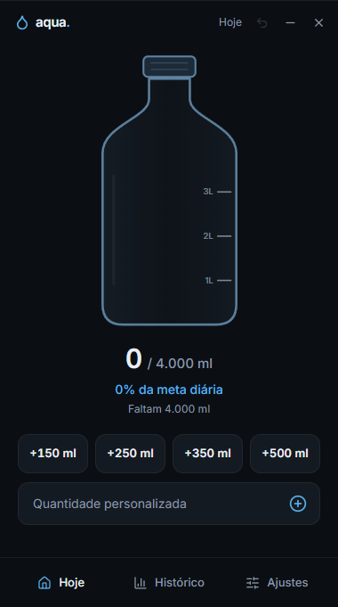
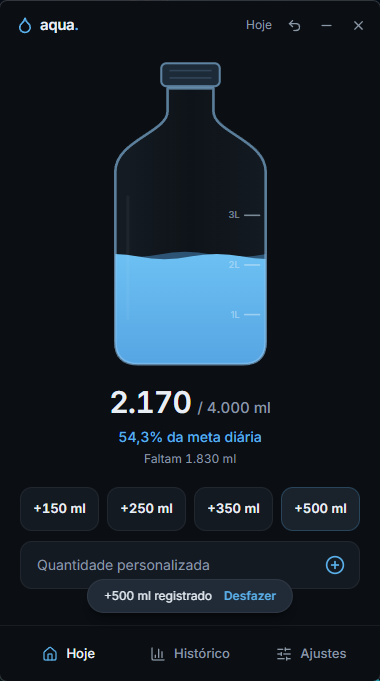
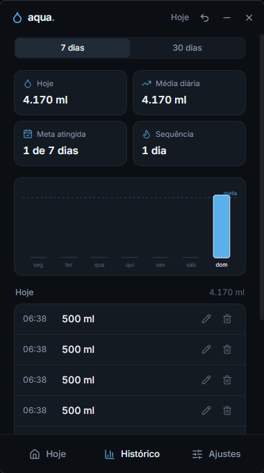

<div align="center">


# Aqua

**A minimal, fast and fully offline desktop water tracker for Windows.**

Log every glass in one click, watch the bottle fill up, and keep your history: no account, no server, no telemetry.

[](https://github.com/kyou0x/drink-water/actions/workflows/ci.yml)
[](LICENSE)


</div>

---

## Screenshots

<table>
  <tr>
    <td align="center"></td>
    <td align="center"></td>
    <td align="center"></td>
    <td align="center"></td>
  </tr>
  <tr>
    <td align="center"><sub><b>Start of the day</b>: empty bottle</sub></td>
    <td align="center"><sub><b>Logging</b>: water rises, with an undo toast</sub></td>
    <td align="center"><sub><b>Goal reached</b>: full bottle, surplus counted</sub></td>
    <td align="center"><sub><b>History</b>: stats, chart and entries</sub></td>
  </tr>
</table>

> The UI is in Brazilian Portuguese. Screenshots are from the real Windows build.

## Features

### 💧 Interactive bottle
- Vertical **SVG bottle** (crisp at any DPI) with a clip path and an animated two-layer wave.
- Starts **empty** each day and **fills in real time** as you log water.
- Volume marks (1 L, 2 L, 3 L…) scale with your goal.
- A subtle glow and rising bubbles play once when you reach **100%**.
- Past the goal, the bottle stays full while the total **keeps counting** (e.g. `Meta atingida · +170 ml`).

### ➕ Logging
- **Quick buttons**: `+150`, `+250`, `+350` and `+500 ml` by default, all configurable.
- **Custom amount** field (`420`, `420 ml` and `1.000` all work). Press Enter to add.
- Each entry stores **date, time and amount**.
- **Undo** the last entry from the toast, the title bar button or `Ctrl+Z`.
- **Edit** (amount and time) or **delete** any entry, including on past days.
- **Double-click protection**: a request in flight or a repeat of the same amount within 500 ms is ignored.

### 📊 Progress & history
- Today: consumed, goal, remaining and percentage (`2.750 / 4.500 ml · 61,1% · Faltam 1.750 ml`).
- **History tab** with 7- and 30-day views: daily average, days the goal was met, current **streak**, and a compact bar chart. Click a bar to see that day's entries.

### 🖥️ Desktop integration
- **System tray** with a custom bottle icon. Left click opens the window; the right-click menu has **Abrir Aqua** and **Sair**.
- Closing the window can either **keep Aqua running in the tray** (default) or **quit**.
- **Start with Windows** (off by default). It launches minimized to the tray.
- **Single instance**: launching Aqua again just brings the existing window to the front.
- No console window in release builds, with its own icon for the app and the installer.

### 🔔 Reminders (optional)
- "Hora de beber água 💧" notifications every **30, 45, 60, 90 or 120 minutes**.
- **Active hours** (e.g. 08:00–22:00, overnight windows are supported) so you are never pinged while sleeping.
- No reminders once the daily goal is reached, and drinking resets the countdown.
- Respects the operating system's notification permission.

### 🔒 Privacy & reliability
- **100% local**: SQLite database in your user profile. No account, no server, no telemetry, no external requests.
- Data is grouped by **local calendar day**. At midnight only the visual progress resets and history is kept. This also works while the app stays open overnight.
- Writes are durable (`WAL` + `synchronous=FULL`), so closing, killing or restarting the app loses nothing.

> **Note:** the default goal of 4,500 ml is just a starting point, **not medical advice**. Water needs vary from person to person, so adjust the goal in *Ajustes*.

## Tech stack

| Layer | Choice |
| --- | --- |
| Desktop shell | [Tauri 2](https://tauri.app) (Rust, WebView2) |
| UI | React 19 + TypeScript, Vite, Tailwind CSS v4, Lucide icons |
| State | Zustand (vanilla store, dependency-injected API and clock for tests) |
| Storage | SQLite via `rusqlite` (bundled), owned by the Rust side |
| Plugins | `notification`, `autostart`, `single-instance` |
| Tests | Vitest (frontend) and `cargo test` (backend) |

## Architecture

```
.
├── src/                      # React frontend
│   ├── components/           # Bottle (SVG), Today / History / Settings views, title bar
│   ├── lib/
│   │   ├── hydration.ts      # pure progress, streak and period calculations
│   │   ├── date.ts           # local-day keys, ranges
│   │   ├── validation.ts     # amount / goal / settings validation
│   │   ├── store.ts          # app state: add, undo, edit, delete, day rollover
│   │   └── api.ts            # typed wrappers around Tauri commands
│   └── test/fakeApi.ts       # in-memory backend used by the store tests
└── src-tauri/                # Rust backend
    ├── src/db.rs             # SQLite schema, migrations, queries
    ├── src/model.rs          # Entry / Settings types + validation
    ├── src/reminder.rs       # pure "should we remind now?" logic
    ├── src/lib.rs            # commands, tray, close behavior, reminder loop
    ├── capabilities/         # minimal Tauri permissions
    └── tauri.conf.json
```

**Security notes**

- The frontend **never runs SQL**. It can only call 7 narrow commands (`add_entry`, `update_entry`, `delete_entry`, `list_entries`, `daily_totals`, `get_settings`, `save_settings`), and every input is validated again in Rust.
- The capability file only grants the window permissions the custom title bar needs (`start-dragging`, `minimize`, `close`).
- A strict **Content Security Policy** is set, and fonts are bundled locally, so the app makes no network requests at runtime.

## Getting started

### Prerequisites (Windows)

1. [Node.js](https://nodejs.org) **20.19+** (24 recommended)
2. [Rust](https://rustup.rs) (stable)
3. [Microsoft C++ Build Tools](https://visualstudio.microsoft.com/visual-cpp-build-tools/) with the **"Desktop development with C++"** workload
4. WebView2 is already included in Windows 10/11.

See the [Tauri prerequisites guide](https://tauri.app/start/prerequisites/) for details.

### Run locally

```bash
git clone https://github.com/kyou0x/drink-water.git
cd drink-water
npm install
npm run tauri dev       # starts Vite + the desktop app with hot reload
```

### Quality checks

```bash
npm run lint            # ESLint
npm run typecheck       # TypeScript
npm test                # Vitest: math, validation, edit/delete, rollover, over-goal

cd src-tauri
cargo fmt --check
cargo clippy --all-targets -- -D warnings
cargo test              # SQLite storage, settings, reminder scheduling
```

### Build the installer

```bash
npm run tauri build -- --bundles nsis
```

Output:

- App: `src-tauri/target/release/aqua.exe`
- Installer: `src-tauri/target/release/bundle/nsis/Aqua_<version>_x64-setup.exe` (per-user install, no admin needed)

Every push to `main` also builds the installer in GitHub Actions. Download it from the run's **Artifacts**.

<details>
<summary><b>Cross-compiling from Linux / WSL (optional)</b></summary>

Aqua can be built for Windows from Linux with [`cargo-xwin`](https://github.com/rust-cross/cargo-xwin), following Tauri's (experimental) cross-compilation guide:

```bash
rustup target add x86_64-pc-windows-msvc
cargo install --locked cargo-xwin
# also required: clang, lld and llvm (llvm-rc) + nsis (makensis) on your PATH
npm run build:win       # tauri build --runner cargo-xwin --target x86_64-pc-windows-msvc
```

Output goes to `src-tauri/target/x86_64-pc-windows-msvc/release/`. On WSL you can run the Rust tests natively on Windows by setting
`CARGO_TARGET_X86_64_PC_WINDOWS_MSVC_RUNNER` to a script that runs `exec "$@"`.

</details>

## Where is my data?

```
%APPDATA%\dev.aqua.tracker\aqua.db
```

It is a plain SQLite file, so you can back it up or inspect it with any SQLite tool. Uninstalling keeps it, unless you tick the uninstaller's "delete app data" option.

## Contributing

Issues and pull requests are welcome.

1. Fork the repository and create a branch: `git checkout -b feat/my-feature`
2. Make sure `npm run lint`, `npm run typecheck`, `npm test` and `cargo test` pass.
3. Use [Conventional Commits](https://www.conventionalcommits.org/) for messages, e.g. `feat(history): add weekly export` or `fix(bottle): clamp wave at 100%`.
4. Open a pull request describing **what** changed and **why**.

## License

[MIT](LICENSE) © kyou0x
