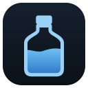
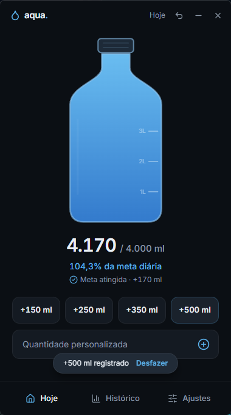

<div align="center">



# Aqua

**A minimal, fast and fully offline desktop water tracker for Windows.**

Log every glass in one click, watch the bottle fill up, and keep your history: no account, no server, no telemetry.

[](https://github.com/kyou0x/drink-water/actions/workflows/ci.yml)
[](LICENSE)


</div>

---

<table>
  <tr>
    <td align="center"></td>
    <td align="center"></td>
    <td align="center"></td>
    <td align="center"></td>
  </tr>
</table>

## Getting started

### Prerequisites (Windows)

1. [Node.js](https://nodejs.org) **20.19+** (24 recommended)
2. [Rust](https://rustup.rs) (stable)
3. [Microsoft C++ Build Tools](https://visualstudio.microsoft.com/visual-cpp-build-tools/) with the **"Desktop development with C++"** workload
4. WebView2 is already included in Windows 10/11.

See the [Tauri prerequisites guide](https://tauri.app/start/prerequisites/) for details.

### Run locally

```bash
git clone https://github.com/kyou0x/drink-water.git
cd drink-water
npm install
npm run tauri dev       # starts Vite + the desktop app with hot reload
```

### Quality checks

```bash
npm run lint            # ESLint
npm run typecheck       # TypeScript
npm test                # Vitest: math, validation, edit/delete, rollover, over-goal

cd src-tauri
cargo fmt --check
cargo clippy --all-targets -- -D warnings
cargo test              # SQLite storage, settings, reminder scheduling
```

### Build the installer

```bash
npm run tauri build -- --bundles nsis
```

Output:

- App: `src-tauri/target/release/aqua.exe`
- Installer: `src-tauri/target/release/bundle/nsis/Aqua_<version>_x64-setup.exe` (per-user install, no admin needed)

Every push to `main` also builds the installer in GitHub Actions. Download it from the run's **Artifacts**.

<details>
<summary><b>Cross-compiling from Linux / WSL (optional)</b></summary>

Aqua can be built for Windows from Linux with [`cargo-xwin`](https://github.com/rust-cross/cargo-xwin), following Tauri's (experimental) cross-compilation guide:

```bash
rustup target add x86_64-pc-windows-msvc
cargo install --locked cargo-xwin
# also required: clang, lld and llvm (llvm-rc) + nsis (makensis) on your PATH
npm run build:win       # tauri build --runner cargo-xwin --target x86_64-pc-windows-msvc
```

Output goes to `src-tauri/target/x86_64-pc-windows-msvc/release/`. On WSL you can run the Rust tests natively on Windows by setting
`CARGO_TARGET_X86_64_PC_WINDOWS_MSVC_RUNNER` to a script that runs `exec "$@"`.

</details>

## Where is my data?

```
%APPDATA%\dev.aqua.tracker\aqua.db
```

It is a plain SQLite file, so you can back it up or inspect it with any SQLite tool. Uninstalling keeps it, unless you tick the uninstaller's "delete app data" option.

## Contributing

Issues and pull requests are welcome.

1. Fork the repository and create a branch: `git checkout -b feat/my-feature`
2. Make sure `npm run lint`, `npm run typecheck`, `npm test` and `cargo test` pass.
3. Use [Conventional Commits](https://www.conventionalcommits.org/) for messages, e.g. `feat(history): add weekly export` or `fix(bottle): clamp wave at 100%`.
4. Open a pull request describing **what** changed and **why**.

## License

[MIT](LICENSE) © kyou0x
